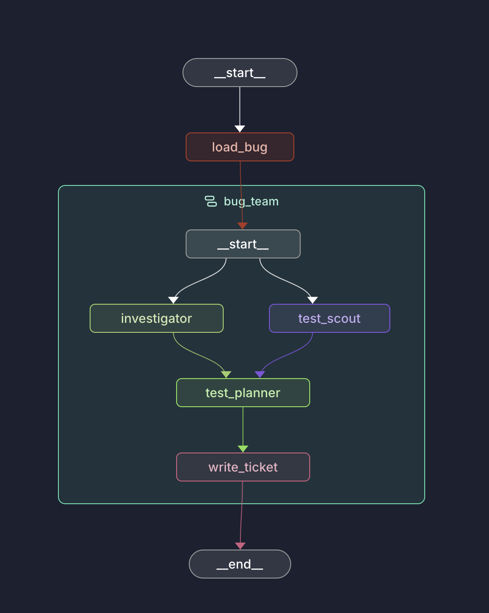

# defectrefiner

[](https://github.com/Hajianrod97/defect_refiner/actions/workflows/tests.yml)

AI refinement for bug reports. A bug report goes in; a ticket a developer can pick up comes out: where the bug is, down to the lines, the likely cause, a fix approach, and a test plan saying where the regression test goes and what to automate.

**Built with:** Python · LangGraph · LangChain · Claude API · Ollama

## How it works



The code discovery agent reads the code to find the cause. At the same time, the testing agent reads the tests to find where this bug's test belongs and what to reuse. The test planner joins the two, and a template writes a draft ticket. A person then approves, edits or rejects each draft, and every decision is logged.


*The pipeline in LangGraph Studio: `investigator` is the code discovery agent and `test_scout` the testing agent, running in parallel.*

## What I found

Tested on 44 closed [datasette](https://github.com/simonw/datasette) bugs. Each agent reads the code from just before the fix, and is scored against the lines the real fix changed. No AI judge.

| | Guess, no code | One agent | Two agents in parallel |
|---|---|---|---|
| First suspect within 10 lines of the fix | 5% | **91%** | 86% |
| Test planned in the fix's test file | – | 9 of 39 | **28 of 39** |
| Time / cost per bug | 4 s / $0.0004 | 27 s / $0.011 | 34 s / $0.015 |

- **Reading the code is what finds bugs.** Without it, the model still names the right file 75% of the time from knowing the repo, but almost never the right lines.
- **The second agent adds the test plan, not a better diagnosis.** Running it in parallel hides its time.
- **Earlier, more agents didn't help.** A five-role team grooming feature tickets never beat one agent, at 3× the time.

Method, numbers and caveats: **[docs/evaluation.md](docs/evaluation.md)**.

## Example tickets

Generated from open datasette issues, for about a cent each:

- **[#3110](docs/tickets/issue-3110.md)**: a real bug, traced to five places in the code that use the bare name `rowid`.
- **[#2924](docs/tickets/issue-2924.md)**: still open on GitHub, but the agent found it was already fixed, and the release notes confirm it.

More in [docs/tickets](docs/tickets).

## Run it

```sh
uv sync
uv run pytest
uv run python -m defectrefiner.bugs team --provider anthropic --model claude-haiku-5-5 --only bug-393
uv run python -m defectrefiner.bugs report runs/bugs-team-claude-haiku-5-5
uv run python -m defectrefiner.bugs open --only 3110 --provider anthropic --model claude-haiku-5-5   # a draft ticket
uv run python -m defectrefiner.web       # review drafts in the browser: approve, edit or reject
uv run langgraph dev                     # the pipeline in LangGraph Studio: refine_bug, {"bug_id": "bug-393"}
```

Claude needs an API key: copy `.env.example` to `.env` and fill it in, or set `ANTHROPIC_API_KEY`; local models run through [Ollama](https://ollama.com) with `--provider ollama`. Repos are cloned into `~/.cache/defectrefiner`.
